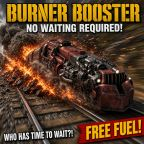

# WePlay: Burner Booster



**Free starter fuel when you place burner entities. Trains too!**

Placing a stone furnace, a burner mining drill, a boiler or a locomotive normally means a second trip to fill it with fuel. Burner Booster takes care of that step: when a burner entity is built, the mod puts some fuel in its fuel slot. You choose which fuel it uses and how much it adds in the mod settings.

- **Factorio version:** 2.1
- **Dependencies:** `base` only (Space Age is not required)
- **Mod portal:** https://mods.factorio.com/mod/WePlayBurnerBooster

---

## Features

- Fuels newly built burner entities: furnaces, burner drills, boilers, locomotives, and any modded entity that uses a burner energy source.
- Works however the entity is built: by the player, by construction robots, on space platforms, and by other mods that raise the standard build events.
- **Automatic mode** chooses a fuel the entity can actually burn, including fuels added by other mods.
- **Manual mode** always uses the fuel you pick, and skips entities that can't burn it.
- Lets you set how much fuel to add, from a single item up to one full stack.

## Settings

All settings are **map settings** (runtime-global), so you can change them during a game.

| Setting | Internal name | Default | Description |
|---|---|---|---|
| Fuel selection mode | `wp-starter-fuel-mode` | `automatic` | **Automatic** chooses a compatible fuel for each entity. **Manual** uses the fuel set below. |
| Fuel for manual mode | `wp-starter-fuel-type` | `coal` | One of `wood`, `coal`, `solid-fuel`, `rocket-fuel`, `nuclear-fuel`. Only used in Manual mode. |
| Starter fuel amount | `wp-starter-fuel-amount` | `1` | Number of items to add (0–1000), capped at one stack of the chosen fuel. **0 means one full stack.** |

---

## How the code works

The mod has two code files: `settings.lua`, which defines the three settings above, and `control.lua`, which handles everything at runtime. It defines no prototypes, so there is no `data.lua`.

### 1. Listening for build events

`control.lua` registers a single handler, `on_built`, for every event that signals a new entity:

```lua
script.on_event({
  defines.events.on_built_entity,                 -- player places it
  defines.events.on_robot_built_entity,           -- construction robot builds it
  defines.events.script_raised_built,             -- another mod creates it
  defines.events.script_raised_revive,            -- another mod revives a ghost
  defines.events.on_space_platform_built_entity   -- built on a space platform
}, on_built)
```

The handler passes `event.entity` to `fuel_new_entity`.

### 2. `fuel_new_entity(entity)`: the main routine

This function works for any entity type, which is why furnaces, drills and locomotives all go through the same path:

1. **Guard checks.** It returns early unless the entity is valid, has a `burner`, and the burner has a valid fuel `inventory`. Entities without a burner (electric machines, belts, etc.) are skipped right away, so the handler is cheap to run on every build.
2. **Fuel selection.**
   - *Automatic*: calls `choose_fuel(burner)`.
   - *Manual*: looks up the item from the `wp-starter-fuel-type` setting and checks it with `accepts(burner, item)`. If the burner can't use that fuel (for example, a modded burner with its own fuel category), the entity is left empty.
3. **Amount.** Reads `wp-starter-fuel-amount`. A value of `0` means a full stack (`item.stack_size`); any other value is capped with `math.min(requested, item.stack_size)`.
4. **Insert.** Calls `inventory.insert{name = ..., count = ...}` on the burner's fuel inventory.

### 3. `accepts(burner, item)`: fuel compatibility

In Factorio 2.1, an item can belong to several fuel categories, and a burner can accept several categories (stored as a lookup table). `accepts` returns `true` when:

- the item exists and has a positive `fuel_value`, **and**
- at least one of the item's `fuel_categories` is present in `burner.fuel_categories`.

Every fuel decision goes through this check, so the mod never inserts something the entity can't burn.

### 4. `choose_fuel(burner)`: automatic selection

Selection happens in two passes:

1. **Vanilla priority list.** It tries `coal → wood → solid-fuel → rocket-fuel → nuclear-fuel` in that order and returns the first one the burner accepts. Ordinary chemical burners therefore always get coal.
2. **Fallback for modded categories.** If none of the vanilla fuels fit (for example, an entity that only burns a fuel category added by another mod), it scans every item prototype and chooses the compatible fuel with the **lowest** `fuel_value`, so it gives out the most modest option. Ties are broken by item name, which keeps the choice the same from run to run regardless of Lua table iteration order.

### Design notes and limitations

- **One-time only.** Fuel is added when the entity is built. The mod never refuels anything afterwards, so it gives you a head start without becoming an infinite fuel source.
- **Cloned entities are not fuelled**, since `on_entity_cloned` isn't handled.
- **Item burners only.** Entities powered by a fluid energy source have no `burner` and are skipped.
- No `storage` (global) state is kept, so the mod is safe to add to or remove from an existing save.

---

## File layout

```
WePlayBurnerBooster/
├── info.json            # Mod metadata (name, version, Factorio 2.1, depends on base)
├── settings.lua         # The three runtime-global settings
├── control.lua          # Build-event handler and fuel selection logic
├── locale/en/locale.cfg # Setting names, descriptions and dropdown labels
├── changelog.txt
└── thumbnail.png
```

## Changelog

**0.0.2** (2026-11-04)
- Handles entities that burn non-standard fuel categories (the modded-fuel fallback in automatic mode).

**0.0.1** (2026-11-04)
- Initial release.

## Other WePlay mods

See the rest of the WePlay mods at https://mods.factorio.com/user/afewvowels